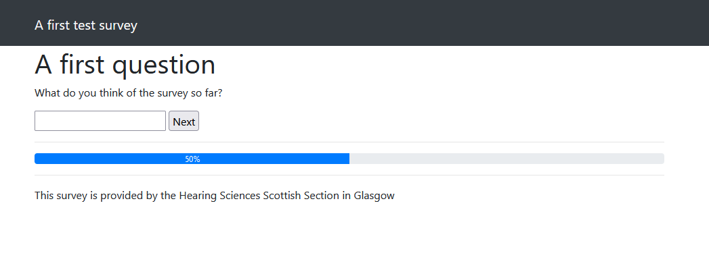
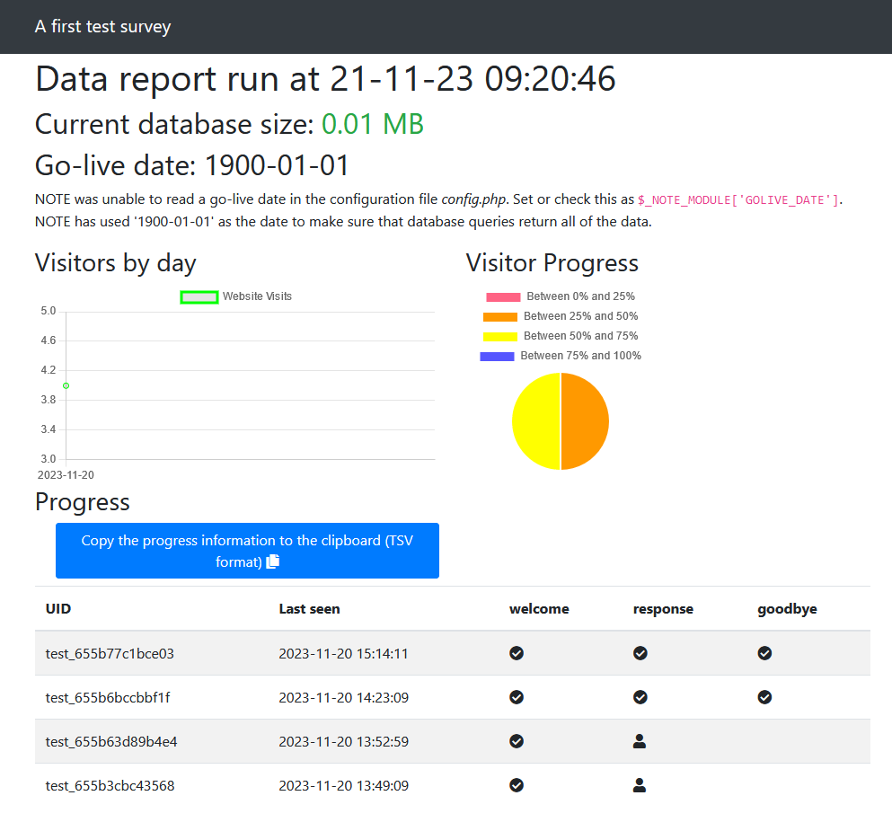
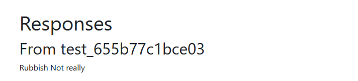

# A first NOTE survey

This assumes that you have set up your development environment and are ready to start creating files.

## This is not a guide to PHP, JavaScript or HTML

Although this guide will step through creating a basic survey it is not intended as a guide to PHP or other scripting languages. Help for these should be sought elsewhere. Some suggestions:

- [https://www.w3schools.com/](https://www.w3schools.com/)
  - Good for PHP, SQL, JavaScript, HTML and Bootstrap
- [https://www.sqlitetutorial.net/](https://www.sqlitetutorial.net/)
  - An excellent reference guide for SQLite

## Getting started

Your survey must contain the following files:

- [config.php](the-conf-file.md) containing the configuration of your survey. This file is used to define the $_NOTE_MODULE array.
- [db.php](the-db-file.md) containing code to save survey results page by page.
- data.php containing code to extract results from surveys.

Click the links to see more information about the layout and content of these files. The example below will not be an exhaustive demonstration of any of these files, but just enough to make a survey 'work.'

This first survey is going to use a folder called `test` so create that folder inside `C:\APPS\nginx\note\modules` (or wherever you have created your development folders).

Inside this folder create four files:

- config.php
- page_welcome.php
- page_goodbye.php
- db.php

Populate these files with the following simple content:

### config.php

```php
<?php

// A first test survey
//
// Author (YOUR NAME GOES HERE), Spring 2024

//==============================================================================
// Overall
//==============================================================================

$_NOTE_MODULE['TITLE'] = 'A first test survey';
$_NOTE_MODULE['PAGETITLE'] = 'A first test survey'; // this is the used at the top of most pages
$_NOTE_MODULE['PAGES'] = [];
$_NOTE_MODULE['FOOTER_COPYRIGHT'] = 'The information and materials on this website are the property of the University of Nottingham and/or Nottingham University Hospitals NHS Trust';
$_NOTE_MODULE['STUDY_TITLE'] = 'A first test survey';

//==============================================================================
// Order of pages
//==============================================================================

$_NOTE_MODULE['PAGES'][] = 'welcome';
$_NOTE_MODULE['PAGES'][] = 'goodbye';

$_NOTE_MODULE['FOOTER_COPYRIGHT'] = 'This survey is provided by the Hearing Sciences Scottish Section in Glasgow';


?>
```

### page_welcome.php

```php
<h1>Welcome to your first ever survey!</h1>

<input type="submit" value="Next" />
```

### page_goodbye.php

```php
<h1>The end</h1>

<p>You have reached the end of this survey.</p>
```

### db.php

```php
<?php

function db_create_tables($db)
{
    $db->exec('CREATE TABLE IF NOT EXISTS visitors (
        id INTEGER PRIMARY KEY,
        uniqueID TEXT,
        ipaddr TEXT,
        lastPage INTEGER,
        timestamp DATETIME DEFAULT CURRENT_TIMESTAMP)'
    );
}

function db_store_page_data($page, &$post, $uid, &$db, &$_NOTE_MODULE) // <-- THIS FUNCTION MUST BE PRESENT
{
}

function display_module_data(&$db, $_NOTE, $_NOTE_MODULE) {
    include $_NOTE['MODULE_DIR'].DIRECTORY_SEPARATOR.'data.php';
}

?>
```

Those files should be enough to make the NOTE survey 'work.' If you browse to `http://localhost:5000/test` you should see the following:


If you click the *Next* button you should be taken to a 'goodbye' page:


Once you are at the 'goodbye' page you can refresh the browser window to go back to the start of the survey.

There are several things to be aware of at this early stage:

- The content and formatting of the header and footer have been created automatically. The survey title has been used in the title bar and the copyright message appears in the footer. There is also a progress bar (although with only two pages it will only show 100% progress at the moment).
- The start and end of an HTML `form` have been created automatically although you need to include a *submit* button so that a visitor can move to the next page.
- If you look in the `test` folder a new `database.sqlite3` file will have been created.
  - If a database file does not already exist (as in this case) PHP automatically creates an empty database.
  - The SQL queries you entered into the *db_create_tables* function in `db.php` (commands starting with `$db->exec`) run to create a *visitors* table that tracks visitors to the survey.
  - The SQL command contains `IF NOT EXISTS` to ensure that the visitors table is only created if it is not already present.
  - The *db_create_tables* function is executed every time a page is loaded so **it is vital that the `IF NOT EXISTS` clause is included** to prevent the table from being continually overwritten.
- If you examine the database in DB Browser for SQLite or another program you will see some data about your 'visit' to the survey has been recorded.

## Adding a page, asking for a response

Now that the beginning and end of the survey has been created it's time to add something to the middle.

### page_response.php

```html
<h1>A first question</h1>

<p>What do you think of the survey so far?</p>

<input type="text" name="response" id="response" />

<input type="submit" value="Next" />
```

The page has been created but it won't appear in the survey until it is added to `config.php`. Add it now:

```php
// Add a line into the section listing pages:

$_NOTE_MODULE['PAGES'][] = 'welcome';
$_NOTE_MODULE['PAGES'][] = 'response'; // <-- HERE
$_NOTE_MODULE['PAGES'][] = 'goodbye';

```

The addition to the PAGES array is the new response page `page_response.php`. There is no need for the whole filename as NOTE adds the `page-` and `.php` automatically.

After the welcome page you should see the new response page:



You can fill in the box and click *Next* but nothing will be saved at the moment. A field in the database will need to be created as well as some code to handle saving the data.

### Adding to db.php

Creating the new table and saving data can all be handled in this file. To add a table if necessary, add the following command to the *db_create_tables* function:

```php
function db_create_tables($db)
{
    // ... other table create statements

    $db->exec('CREATE TABLE IF NOT EXISTS responses (
        id INTEGER PRIMARY KEY,
        uniqueID TEXT,
        response TEXT,
        timestamp DATETIME DEFAULT CURRENT_TIMESTAMP)');
}
```

This will create a table and add a field to store the response. It will also include a column for the unique ID (so you know which visitor issued which response) and a timestamp (so you know when the response was made). The extra columns are optional but useful.

To handle saving the data, the function *db_store_page_data* needs to be changed. This function handles data for all of the survey pages, so it needs to check that this is data for the *response* page. It also needs to make sure that the data is sanitised. It can achieve this in two ways: running specific data-santitising functions and by using prepared SQL statements. Here is the updated function:

```php
function db_store_page_data($page, &$post, $uid, &$db, &$_NOTE_MODULE) 
{
    switch($_NOTE_MODULE['PAGES'][$page]) {
        case 'response':
            $response = preg_replace("/[^0-9A-Za-z ]/","", $post['response']);

            $qry    = $db->prepare('INSERT INTO responses (uniqueID, response, timestamp) VALUES (:uid, :response, :timestamp)');
            $result = $qry->execute([
                ':uid' => $uid,
                ':response' => $response,
                ':timestamp' => date('Y-m-d H:i:s')
            ]);
            break;
    }
}
```

With this extra code in place you can enter a response and it will be saved in the database.

The data sanitisation process above removes any characters that aren't alphanumeric or spaces. This might be too severe depending on your survey; care must always be taken to ensure that a participant response cannot break or hack the survey but you still get the data you need.

The prepared SQL statement protects against [SQL injection attacks](https://en.wikipedia.org/wiki/SQL_injection).

## data.php

A page should now be written to retrieve any saved responses. Create a file called `data.php` and copy in the following code:

```php
<?php
    $query = 'SELECT * FROM responses';
    $result = $db->query($query);
?>
<h1>Responses</h1>

<?php foreach($result as $row): ?>
    <h2>From <?= $row['uniqueID'] ?></h2>
    <p><?= $row['response'] ?></p>
<?php endforeach; ?>
```

This simple code retrieves and displays all of the data from the *responses* table. There aren't any variables in the SQL query so a prepared statement isn't needed (although you could use one if you wanted).

You should be able to view the data by visiting:
`http://localhost:5000/data/test`

You should see the following generated by NOTE:

- The date of the report (i.e. now)
- The size of the SQLite database
- A go-live date
- Charts of visitors and their progress through the survey
- A table of visitors and their progress



You should then see details of any visitors to the site and their responses. 

If a go-live date is configured, the charts of visitors only include participants who took part in this survey after that date. It is an easy way to exclude earlier visits for testing and piloting purposes.

If you entered any responses containing punctuation you should see that these characters were removed (see above about data sanitisation). In the example below the original response ('Rubbish! Not really.') has been sanitised.



If this code was being used on a live server then extra precautions would by needed to prevent the data from being shown to anyone visiting the site.
