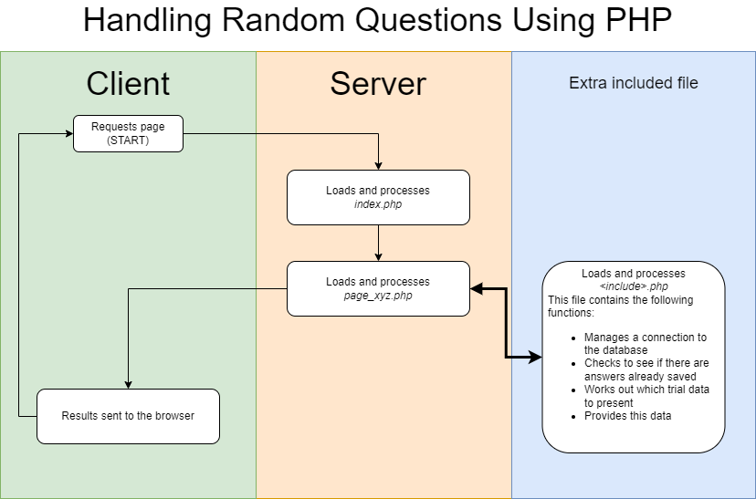
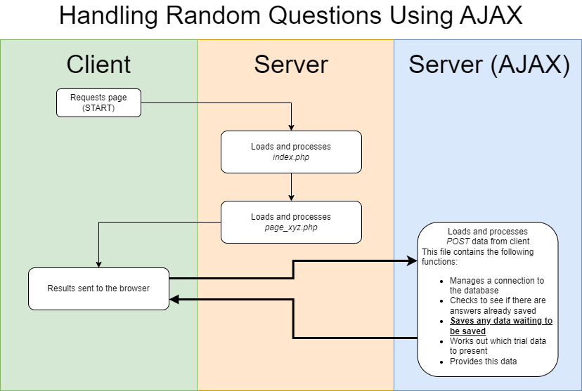

# Presenting surveys with randomised order of questions

There are plenty of surveys that require their questions to be presented in a random order, and different for each participant. This is achievable within NOTE given some preparation.

I don't claim that the following guide is the only way to achieve this but I have used both of the solutions given here many times and have found them to be robust. And if that doesn't tempt fate, nothing will.

Throughout this guide *{survey}* represents the name of your survey and other entries in {brackets} should be replaced with something more meaningful. (There may be other things you should change - this everybody's mileage will vary.) Keep it simple.

## The alternatives

Briefly, there are two ways of achieving this: calling the PHP page multiple times or using a single PHP page using multiple AJAX requests (see images below).





## Both solutions - sort out the question data

With most surveys of this type there are many similar questions; similar both in the question being asked and the format of the answer. Since there is likely to be a predictable structure, put the questions into the database.

### Question table

Create a table in the database ideally called *{survey}-questions* and lay out the fields. They could be:

- ID*
  - **Every** table should have an ID column that auto-increments. It doesn't have to be meaningful to the survey but will be important for linking questions to responses. If you skip it you'll regret it.
  - question_number* This is optional and would be the question number as defined in whatever documentation you have. Some surveys don't have them, but others rely on the question numbers later for scoring. Don't use the *ID* column as a question number if the survey has it's own numbering system.
  - question*
  - This is probably the text of the question that will be presented to participants

There may be other fields, and that's up to the survey. If the responses could be different (maybe some questions have a yes/no response but others have yes/no/maybe), you will want a column in the table to reflect this.

### Response table

You (obviously) want a table to store the responses. This will have the following fields at least:

- ID*
  - Here it is again. **Every** table should have an ID column that auto-increments.
  - UID*
  - The UID of the participant (generated by NOTE but needs to be saved).
  - question_id*
  - This is the **ID** of the question in the questions table, not the question number. Trust me on this! You must have this to link responses to questions when you want to analyse your data.
  - response*
  - No surprises here - you need to save the response.
  - timestamp*
  - Record the date and time of the response. It never hurts to know when someone completed your survey.

## Solution one - many pages, mostly PHP

This is probably the easier solution as it uses more of NOTE's in-built functions. If you are planning to present your survey over many pages, maybe one page per question, this solution will work for you.

### Config.php

You will need to make sure that your survey page appears many times in the *config.php* file. You can just add the page many times:

```php
$_NOTE['PAGES'][] = 'page_{survey}.php;
$_NOTE['PAGES'][] = 'page_{survey}.php;
$_NOTE['PAGES'][] = 'page_{survey}.php;
$_NOTE['PAGES'][] = 'page_{survey}.php;
...etc...
```

That's not great programming though. If you know how many pages, just use this:

```php
foreach (range(1, x) as $i) {
    $_NOTE['PAGES'][] = 'page_{survey}.php;
}
```

Where *x* is the number of pages you will use. If the number needs to change at a later date, it's easy to just change *x*.

#### Handy tip

If you have many iterations of a page and need to keep track of the page from within the survey, add the following line to *config.php*:

```php
$_NOTE_MODULE['START_OF_REPEATING_PAGE'] = count($_NOTE_MODULE['PAGES']);
foreach (range(1, x) as $i) {
    $_NOTE['PAGES'][] = 'page_{survey}.php;
}
```

Replace *START_OF_REPEATING_PAGE* with something memorable for you. With this stored, you can use it combined with the variable containing the current page (*`$_NOTE['PAGE']`*).

### page_{survey}.php

Your survey page will need to choose some data to show. Either in the top of the file or an included file, make a connection to the database and load some data. The code to establish a database connection will look something like this:

```php
    try {
        $db = new PDO('sqlite:'.$note["MODULE_DIR"].DIRECTORY_SEPARATOR.'database.sqlite3');
        $db->setAttribute(PDO::ATTR_ERRMODE, PDO::ERRMODE_EXCEPTION);
    }
    catch(PDOException $e) {
      // Log error
      echo $e->getMessage();
      die;
    }
        
```

By executing the code in a *try... catch* block you have the opportunity to act if something goes wrong.
With the database connection, the code to choose a question at random will look something like this:

```php
$qry = $this->db->prepare('SELECT {fields} FROM {questions table} WHERE id NOT IN (SELECT question_id from {answers table} where UID=:uid) ORDER BY RANDOM() LIMIT 1;');
$qry->execute(array(':uid' => $this->uid));
$question = $qry->fetchAll(PDO::FETCH_ASSOC);
```

As ever in this guide, replace {bracketed} text with your own fields, table names etc.
*$question* should be an array containing (in this case) one further array of question data:

```php
print_r($question)
// Should print something like:
Array
(
    [0] => Array
    (
        id => {question ID}
        question => {your question}
    )
)
```

So you would refer to fields in your data as *`$question[0][{field}]`*. If you asked for more questions, they would be available as *`$question[1]`*, *`$question[2]`* etc.

## Solution two - single page using AJAX

The process of updating questions in place bypasses many of NOTE's processes and functions so please be aware at the outset that you will be writing more code and creating your own 'mini NOTE' within the survey.

### *Config.php*

This will contain a single entry for your page, like any other NOTE survey.

### Server-side PHP file

This file will be called by your survey and never be used 'directly.'

As it isn't part of NOTE's configuration you can call this file anything you like. I have gone with the name of the survey starting with a capital letter e.g. Ssq12.php, Hhie.php etc.

This file will need to:

- Establish a connection to the database
- Validate and save any submitted data
- Retrieve question data to return to the browser

Establishing a connection is easy and covered above:

```php
    try {
        $db = new PDO('sqlite:'.$note["MODULE_DIR"].DIRECTORY_SEPARATOR.'database.sqlite3');
        $db->setAttribute(PDO::ATTR_ERRMODE, PDO::ERRMODE_EXCEPTION);
    }
    catch(PDOException $e) {
      // Log error
      echo $e->getMessage();
      die;
    }
        
```

Because the file is called using AJAX it must process and return data in a format that AJAX can understand. This line should retrieve submitted data:

```php
$request = json_decode(file_get_contents('php://input'), true);
```

One of the data entries will be *action*, probably either *get* or *save*. You can use a PHP *switch/case* block to read the value of action and work with the options.

#### Handy tip #2

One feature of the PHP *switch/case* system is that individual cases don't need to be terminated. You can take advantage of this: when the code saves data you know that you will need to look for more. So start with the *save* case and move to the *get* case **without** a *break*:

```php
switch($action) {
    case 'save':
        // Validate and save the data
        
    case 'get':
        // Get some question data
        
    break;
}
```

This is valid but should be treated with caution.

Remember that **you will need to check the data** before sending it to the database. Saving data is the same as with any NOTE survey, so refer to that documentation if you need help.

Retrieving question data is the same as before:

```php
$qry = $this->db->prepare('SELECT {fields} FROM {questions table} WHERE id NOT IN (SELECT question_id from {answers table} where UID=:uid) ORDER BY RANDOM() LIMIT 1;');
$qry->execute(array(':uid' => $this->uid));
$question = $qry->fetchAll(PDO::FETCH_ASSOC);
```

Again, substitute your own field and table names into the example above. Once you have a response, it will need to be returned to the browser. AJAX responses are simply print statements run in this file:

```php
echo json_encode($response);
```

You need *json_encode* to format the data. Also bear in mind that the script **must not print anything else** as this will break the JSON response.

### JavaScript in your survey page

Your survey page will contain mostly HTML and JavaScript so the code will be different from before. My advice would be:

#### Create an object to talk to the server

Here's the JavaScript used in the example HHIE survey:

```javascript
const Hhie = {
        linkToServer: async function(action, answers) {
            let data = {
                "action": action,
                "uid": '<?= $_NOTE['UID'] ?>'
            };
            if (answers) {
                data['answers'] = answers;
            }

            let res = await fetch("<?= $_NOTE["MODULE_PATH"].DIRECTORY_SEPARATOR ?>Hhiea.php", {
                method: 'POST',
                mode: 'cors',
                body: JSON.stringify(data)
            });
            json = await res.json();
            return json;
        }
    }
```

JavaScript is a bit odd in that variables can contain functions. So in the example above I've created a variable *Hhie* that contains a function to talk to the server. This uses the FETCH API (look for the *fetch* statement in the code) and also *async/await*. These two commands work in tandem to make sure the code actually waits for a response before doing anything. (The first 'A' in AJAX stands for 'asynchronous' but in this instance we want to wait for the reply.)
If you copy this code, replace *Hhie* with more appropriate variable and page names.

#### Fetch some data

The code hasn't actually 'done' anything yet! To fetch some data, add some code to a *$(document).ready()* function:

```javascript
$(document).ready(function() {
        Hhie.linkToServer('get', null).then(data => {
            setQuestions(data);
            prepPage();
        }).catch(err => {
            console.log(err);
        });

/// ...The rest of the actions for this function
});
```

When you want to save data, you will need to capture it from the page in something AJAX-friendly and send it to the server. Don't forget to validate the data here as well:

```javascript
// checkAnswers() should be a function to check everything
if (checkAnswers()) {
    answers = JSON.stringify($('form').serializeArray());
    Hhie.linkToServer('post', answers).then(data => {
        setQuestions(data);
    });
}
```

This code sends the data to be saved, then (literally with the function *then*) sets up the next question using the data that was returned. The *setQuestions* function can check that some data actually **was** returned, and if not it could print a statement saying the survey is complete.
