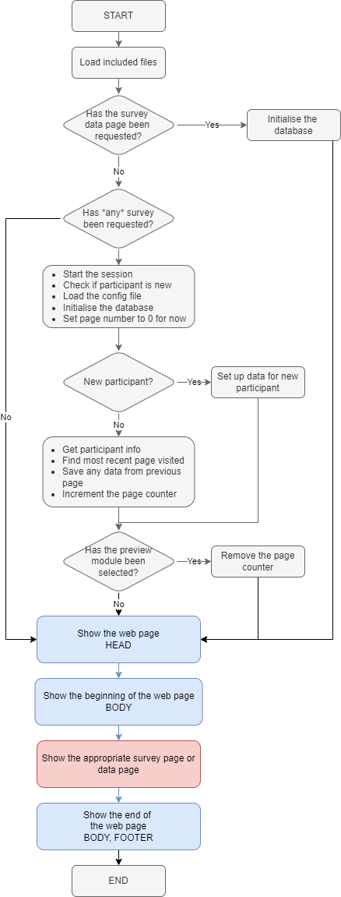

# Anatomy of a web page

Each time someone views a page in NOTE, the same *index.php* file is used as a framework. The steps taken can be seen in the flowchart below. Grey shading represents steps that are taken by the NOTE code, blue shading represents steps that are taken by the NOTE code and visible to the participant's browser, and red shading represents steps that require code written by staff.

There are a couple of things that become apparent. The first is that the NOTE code is handling most of the work behind the scenes, reducing the development time as much as possible. The other is that the bulk of the processing is done on the server when the page is requested and before the page is delivered to the browser.

Here is a brief explanation of the steps involved:

## Set up the autoloader

As well as *index.php* NOTE sets up an *autoloader* for finding classes. There are three classes: *Survey*, *Participant* and *ErrorHandler*. There is no longer a dedicated variable containing a link to the database; $db has been replaced by a Participant db property ($noteSurvey -> Participant -> db). A $db is created for backwards compatibility but this is deprecated.

**The *db.php* file is part of a survey and isn't provided by NOTE.**

## Has the survey data page been requested?

(This question is no longer valid.) A dedicated *data.php* page handles data presentation. This question will be removed when later versions of NOTE are released.

## Getting things started

* Start the session
* Check if participant is new
* Load the config file
* Initialise the database
* Set page number to zero for now

These steps gather information about the participant.

A *session* is used to retain data between pages, and is the reason that a message about cookies must be displayed.

If the session data lacks participant information, the code can conclude that the participant must be new and sets up a user ID (UID).

The configuration file *config.php* is loaded from the survey directory, and the code connects to the database file *database.sqlite3* (also in the survey directory).

For the time being, the current page number is set to zero (and may be updated later).

## New participant?

If the participant is new (the code checked that earlier, see above) then set up some initial data.

Otherwise, the information for the current participant is retrieved using its UID. This includes:

* The most recent page visited. This updates the page number.
* Any data that was created in the previous page. All of this data is your survey data so it's very important that it's treated with care! Data that is found is passed to a function *db_store_page_data* that must be present in the *db.php* file created for that survey. ***NOTE will not save survey data automatically.***
* If the previous steps didn't generate any errors, the page number is incremented.

## Has the preview module been selected?

This option can be activated using */preview/* at the end of the URL. This causes the page to show *Next* and *Previous* buttons and can override the normal flow of the survey. This can be useful for debugging.

## Is there data to save?

## Show the web page HEAD

This section generates the HTML required at the start of a web page, creating a title and loading supporting styles and scripts.

## Show the beginning of the web page BODY

We're finally displaying information that a participant will actually see! The NOTE code shows the title banner containing the title that was set in *config.php*. The NOTE code also creates the start of the HTML form that will be used to gather survey data.

## Show the appropriate survey page or data page

At this point, a participant will see a page that has been created for the survey. The pages are prepared in an array in *config.php* and the code uses the page number to determine which page to display.

If the data page has been requested, that will be displayed instead.

## Show the end of the web page BODY, FOOTER

The NOTE code completes the HTML form and shows a progress bar. The final parts of the HTML are generated and the page is finished.

