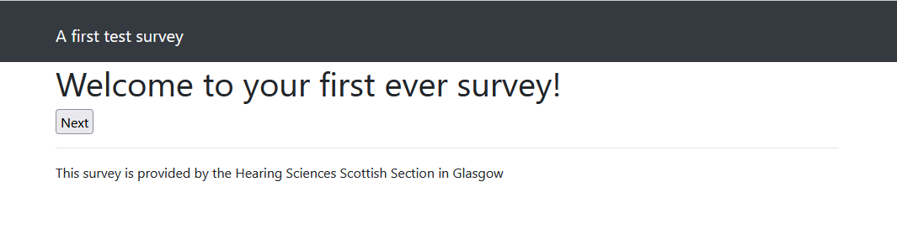
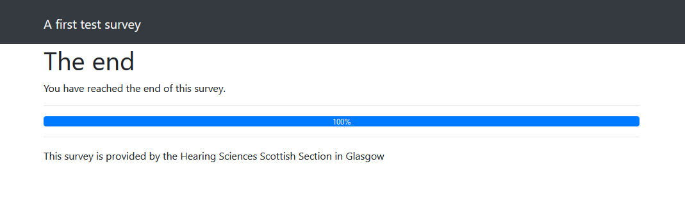

# A first NOTE survey

This assumes that you have set up your development environment and are ready to start creating files.

Your survey must contain the following files:

- [config.php](the-conf-file.md) containing the configuration of your survey. This file is used to define the $_NOTE_MODULE array.
- [db.php](the-db-file.md) containing code to save survey results page by page.
- data.php containing code to extract results from surveys.

Click the links to see more information about the layout and content of these files. The example below will not be an exhaustive demonstration of any of these files, but just enough to make a survey 'work.'

This first survey is going to use a folder called `test` so create that folder inside `C:\APPS\nginx\note\modules` (or wherever you have created your development folders).

Inside this folder create four files:

- config.php
- page_welcome.php
- page_goodbye.php
- db.php

Populate these files with the following simple content:

## config.php

```php
<?php

// A first test survey
//
// Andrew Lavens, November 2023

//==============================================================================
// Overall//
//==============================================================================

$_NOTE_MODULE['TITLE'] = 'A first test survey';
$_NOTE_MODULE['PAGETITLE'] = 'A first test survey'; // this is the used at the top of most pages
$_NOTE_MODULE['PAGES'] = [];
$_NOTE_MODULE['COPYRIGHT'] = 'The information and materials on this website are the property of the University of Nottingham and/or Nottingham University Hospitals NHS Trust';
$_NOTE_MODULE['STUDY_TITLE'] = 'A first test survey';

//==============================================================================
// Order of pages
//==============================================================================

$_NOTE_MODULE['PAGES'][] = 'welcome';
$_NOTE_MODULE['PAGES'][] = 'goodbye';

$_NOTE_MODULE['FOOTER_COPYRIGHT'] = 'This survey is provided by the Hearing Sciences Scottish Section in Glasgow';


?>
```

## page_welcome.php

```php
<h1>Welcome to your first ever survey!</h1>

<input type="submit" value="Next" />
```

## page_goodbye.php

```php
<h1>The end</h1>

<p>You have reached the end of this survey.</p>
```

## db.php

```php
<?php

$db->exec('CREATE TABLE IF NOT EXISTS visitors (
        id INTEGER PRIMARY KEY,
        uniqueID TEXT,
        ipaddr TEXT,
        lastPage INTEGER,
        timestamp DATETIME DEFAULT CURRENT_TIMESTAMP)');

function db_store_page_data($page, &$post, $uid, &$db, &$_NOTE_MODULE) 
{
}

function display_module_data(&$db, $_NOTE, $_NOTE_MODULE) {
    include $_NOTE['MODULE_DIR'].DIRECTORY_SEPARATOR.'data.php';
}

?>
```

Those files should be enough to make the NOTE survey 'work.' If you browse to `http://localhost:9090/test` you should see the following:



If you click the *Next* button you should be taken to a 'goodbye' page:


