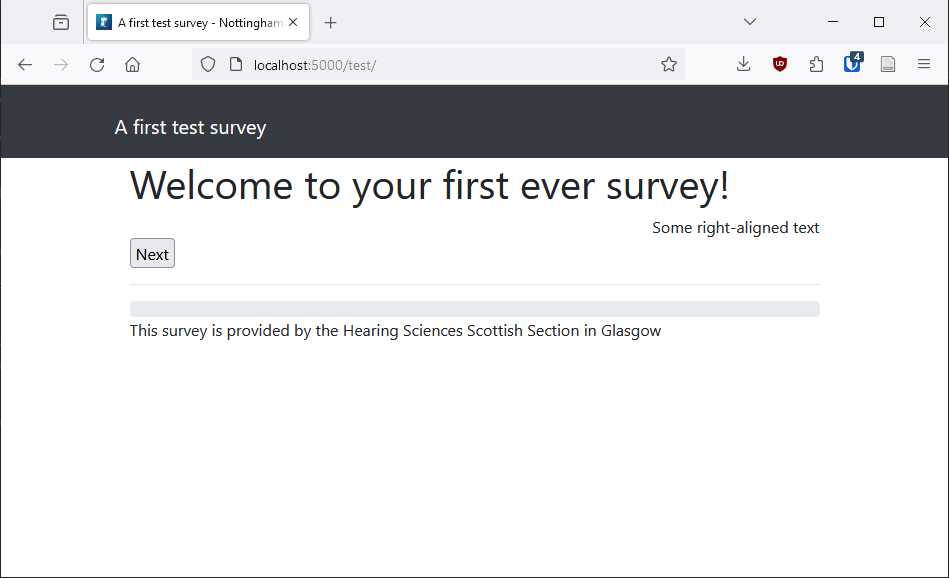
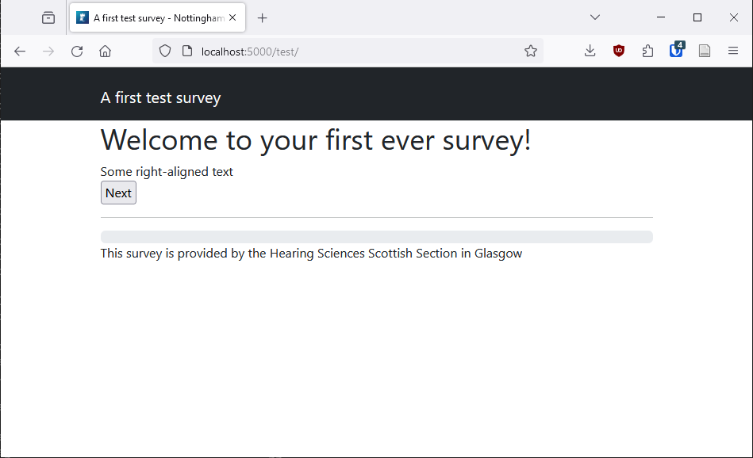
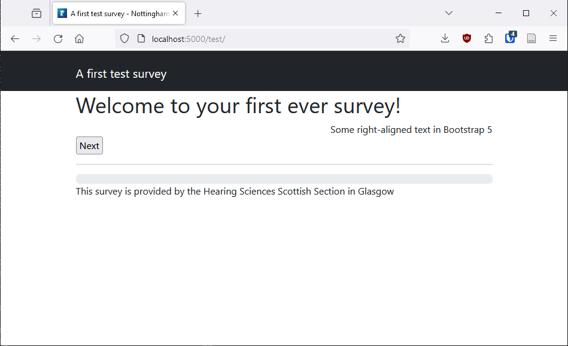
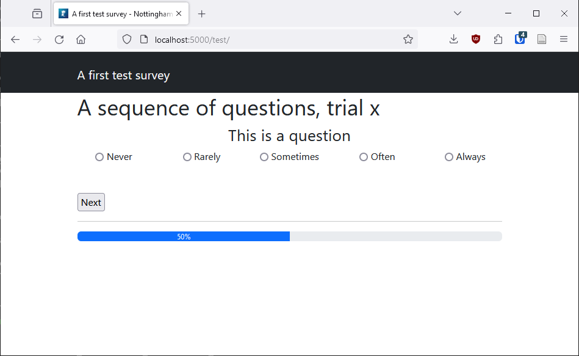
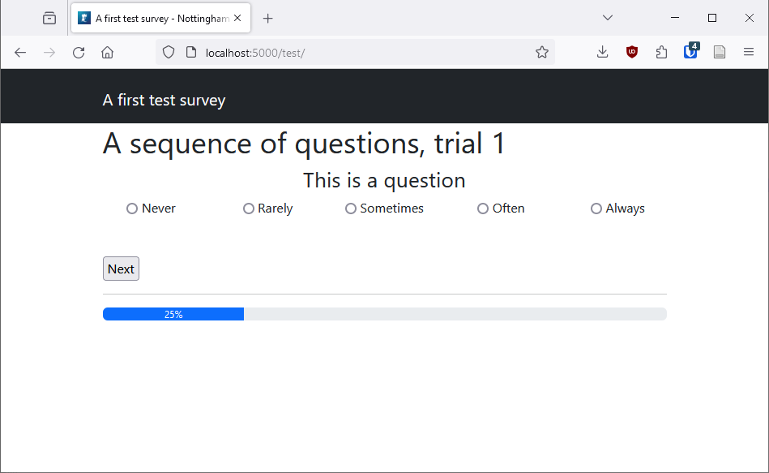
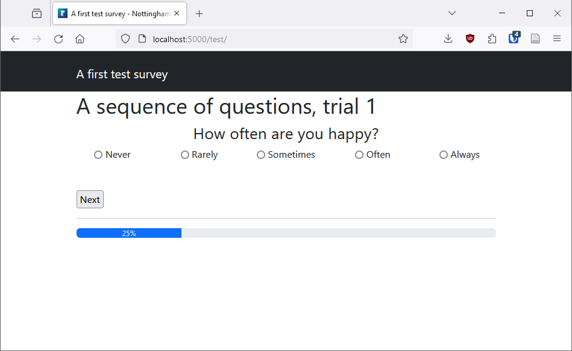
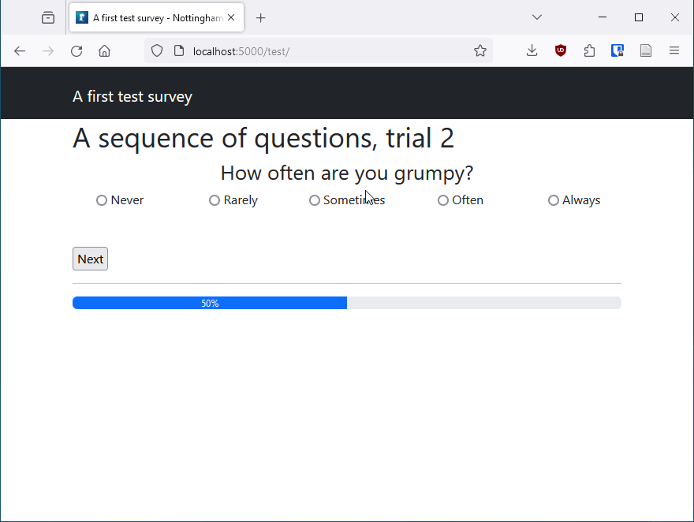
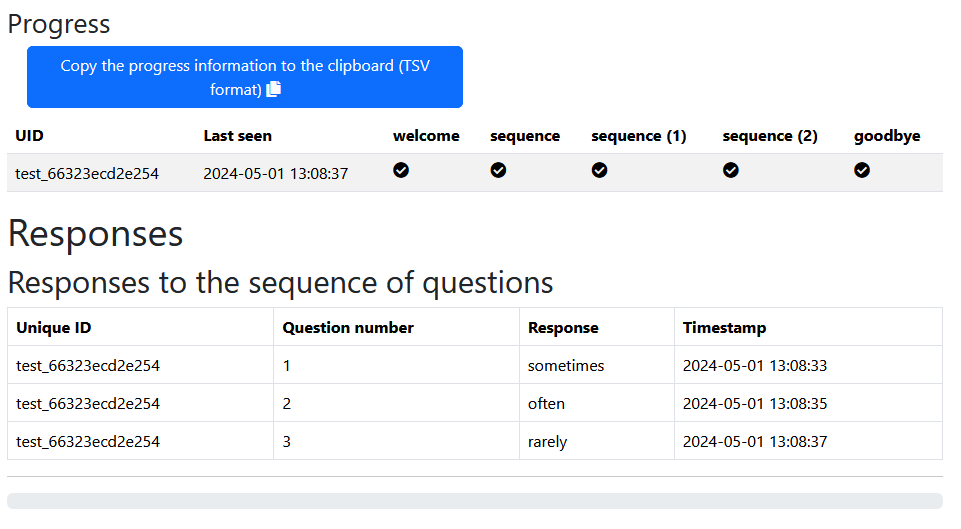

# Extending your survey

Now that you have a working survey, there are various ways to extend its capabilities.

(If you *don't* have a working survey please see [how to create a first note survey](A-first-NOTE-survey.md).)

## Libraries

Libraries are provided through jsDelivr, a public archive of open source projects. This minimises the number of libraries you must download and manage yourself. For the most common libraries it is only necessary to create an array of names.

NOTE should load the Bootstrap 4 libraries by default, so let's test this. Before you add a library, add the following to *page_welcome.php* after the title:

```php
<div class="text-right">Some right-aligned text</div>
```

When you view this page you should see that the text is right-aligned as expected.



This is because we are using the Bootstrap 4 class *text-right* for right-aligning text. But Bootstrap version 5 has been available for a long time and it is probably better to develop new surveys using the more recent library. In your config file *config.php* add the following after the survey title:

```php
$_NOTE_MODULE['CSS_LIBRARIES'] = ['bootstrap5'];
$_NOTE_MODULE['JS_LIBRARIES'] = ['bootstrap5'];
```

Note that the options are being declared as arrays even though you are specifying one library in each. This makes it easy to add libraries later if necessary.

This should cause NOTE to load the JavaScript and CSS libraries for Bootstrap 5 and not 4. If you save and refresh the page you should see that the text is no longer right-aligned.



Why is this? One of the breaking changes introduced in Bootstrap 5 was the replacement of '*-right*' with '*-end*' in all class names. (Similarly, '*-left*' was replaced by '*-start*'.) So the class *text-right* no longer has any meaning within Bootstrap. To fix this we should update the code on *page_welcome.php*:

```php
<div class="text-end">Some right-aligned text in Bootstrap 5</div>
```

If you save and refresh the page again the text should be right-aligned again:



By seeing the code 'fail' and changing it you have been able to confirm that Bootstrap 5 is loading correctly.

## Working with multiple buttons and pages

(This information is unlikely to be of use to seasoned programmers as it covers ways to keep code DRY. You may have your own techniques which is fine; NOTE is lightweight so people are free to go their own way.)

Imagine that you wanted to include a three-page sequence of trials somewhere within your survey. Each page will contain a question followed by a series of radio buttons so the participant can select an answer. It would be ideal to use the same page each time to keep the code DRY (Don't Repeat Yourself) but it would also be nice for the pages to be headed *Trial 1*, *Trial 2* and *Trial 3*. Most importantly, different questions should be displayed on each page.

### Buttons using a *foreach* loop

Create a new document *page_sequence.php* with the following contents:

```php
<h1>A sequence of questions, trial x</h1>

<div class="h3 text-center">This is a question</div>

<div class="row mb-5">
    <div class="col text-center">
        <input type="radio" name="response" id="response-never" value="never" />
        <label for="response-never">Never</label>
    </div>
    <div class="col text-center">
        <input type="radio" name="response" id="response-rarely" value="rarely" />
        <label for="response-rarely">Rarely</label>
    </div>
    <div class="col text-center">
        <input type="radio" name="response" id="response-sometimes" value="sometimes" />
        <label for="response-sometimes">Sometimes</label>
    </div>
    <div class="col text-center">
        <input type="radio" name="response" id="response-often" value="often" />
        <label for="response-often">Often</label>
    </div>
    <div class="col text-center">
        <input type="radio" name="response" id="response-always" value="always" />
        <label for="response-always">Always</label>
    </div>
</div>

<input type="submit" value="Next" />
```

You will also need to change the configuration file *config.php* so that the page is displayed. Replace the 'response' page with 'sequence:'

```php
$_NOTE_MODULE['PAGES'][] = 'welcome';
$_NOTE_MODULE['PAGES'][] = 'sequence';
$_NOTE_MODULE['PAGES'][] = 'goodbye';
```

Now when you load the survey and move past the welcome page you should see the new sequence page:



Now that the page exists let's start making improvements.

First of all, having code for each button means that the code isn't DRY. Replace all of the button code with the following:

```php
<?php foreach (['never', 'rarely', 'sometimes', 'often', 'always'] as $response): ?>
<div class="col text-center">
    <input type="radio" name="response" id="response-<?= $response ?>" value="<?= $response ?>" />
    <label for="response-<?= $response ?>"><?= ucfirst($response) ?></label>
</div>
<?php endforeach; ?>
```

### Bookmarks

The title and question can also be generated using PHP, but in these cases the text will change *between* pages rather than *within* each page. This can be achieved using a *bookmark* and comparing it to the current page.

In the *config.php* replace the ```$_NOTE_MODULE['PAGES'][] = 'sequence';``` code with the following:

```php
$_NOTE_MODULE['SEQUENCE_START_PAGE'] = count($_NOTE_MODULE['PAGES']) - 1;
foreach(range(1,3) as $i) {
    $_NOTE_MODULE['PAGES'][] = 'sequence';
}
```

We have created a bookmark along with three *sequence* pages. The pages have been appended to the *PAGES* array using a ```foreach``` loop so that the code is DRY. It will be easy to change this later if 5, 10 or 20 sequence pages were needed.

Now add the following at the top of *page_sequence.php*:

```php
<?php
    $page_number = $noteSurvey->getPage() - $_NOTE_MODULE['SEQUENCE_START_PAGE'];
?>
```

Change the title to this:

```php
<h1>A sequence of questions, trial <?= $page_number ?></h1>
```

Now when you save and refresh the page you should see this:



In theory when you move to the next page, *trial 1* will change to read *trial 2*. But don't do that yet! First let's change the code that displays a question. Add the following to the PHP block at the start of *page_sequence.php*:

```php
$questions = [
    1 => 'How often are you happy?',
    2 => 'How often are you grumpy?',
    3 => 'How often are you sad?',
];
```

And change the question to the following:

```php
<div class="h3 text-center"><?= $questions[$page_number] ?></div>
```

When you save and refresh the page you should see the first question:



Now when you select an answer and move to the next page, you should see *trial 2* and a new question.



## Saving the data

At the moment there's no code for saving these responses. But there's also no code to record the trial number. Let's add that now. In *page_sequence.php* add the following line before the ```foreach``` loop:

```php
<input type="hidden" id="question_id" name="question_id" value="<?= $page_number ?>">

<?php foreach (['never', 'rarely', 'sometimes', 'often', 'always'] as $response): ?>

...
```

This will add a hidden form field on the page that has a value of the current page number. Then when the form is submitted the code in *db.php* can add this to the data being saved.

In *db.php* add the following to the function ```db_create_tables```:

```php
function db_create_tables($db)
{
    // ... other 'create' statements

    $db->exec('CREATE TABLE IF NOT EXISTS sequence_responses (
        id INTEGER PRIMARY KEY,
        uniqueID TEXT,
        question_id INTEGER,
        response TEXT,
        timestamp DATETIME DEFAULT CURRENT_TIMESTAMP)');
}
```

Then add the following to ```db_store_page_data```:

```php
function db_store_page_data($page, &$post, $uid, &$db, &$_NOTE_MODULE) 
{
    switch($_NOTE_MODULE['PAGES'][$page]) {

        case 'sequence': // <-- add this
            $qry    = $db->prepare('INSERT INTO sequence_responses (uniqueID, question_id, response, timestamp) VALUES (:uid, :question_id, :response, :timestamp)');
            $result = $qry->execute([
                ':uid' => $uid,
                ':question_id' => $post['question_id'],
                ':response' => $post['response'],
                ':timestamp' => date('Y-m-d H:i:s')
            ]);
        break;

        // ... other cases

    }
}
```

To see the data, add the following to *data.php*:

```php
<?php
    $query = 'SELECT * FROM sequence_responses order by uniqueID, question_id';
    $result = $db->query($query);
?>
<h2>Responses to the sequence of questions</h2>

<table class="table table-bordered">
<tr>
    <th>Unique ID</th>
    <th>Question number</th>
    <th>Response</th>
    <th>Timestamp</th>
</tr>
<?php foreach($result as $row): ?>
    <tr>
        <td><?= $row['uniqueID'] ?></td>
        <td><?= $row['question_id'] ?></td>
        <td><?= $row['response'] ?></td>
        <td><?= $row['timestamp'] ?></td>
    </tr>
<?php endforeach; ?>
</table>
```

Now you can complete the survey and see your answers on the data page:


