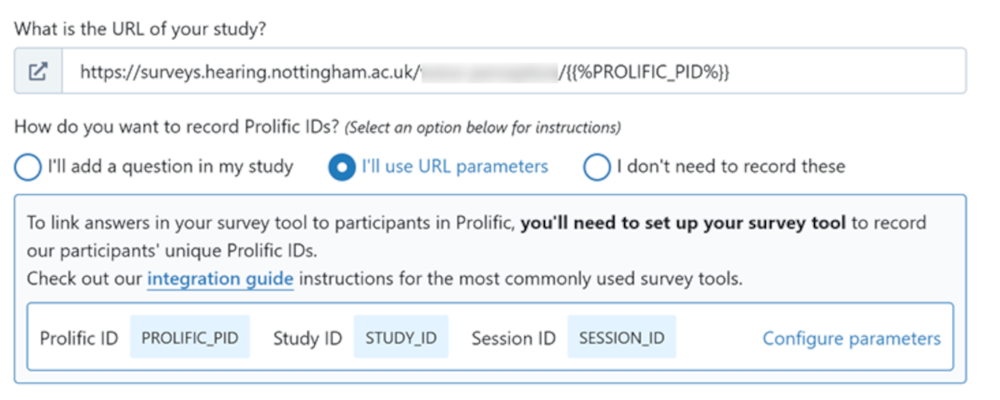

# Integrating NOTE with Prolific
It is possible to recruit participants from Prolific ([https://prolific.co](https://prolific.co)) and pass their IDs to and from NOTE. Here's how to do it:
There are two pieces of information required to link NOTE to Prolific: 
## Prolific -> NOTE
*(Someone with access to the server does this bit)*

The scientist needs to receive a URL to feed into Prolific. This is always in the form:
* https://surveys.hearing.nottingham.ac.uk/(NAME-OF-SURVEY-FOLDER)/{}

Include the name of the survey folder (without brackets). This is non-standard from Prolific’s point of view so it’s always necessary to tread carefully. 

The Scientist will add the URL to their study setup page using the option *I'll use URL parameters* (see image below).



With this URL, it is possible to capture the PID within NOTE using *$_NOTE[‘PART_ID’]*. Saving the PID into a database is still the responsibility of the scientist / programmer, as NOTE won’t do this automatically. I always include a page with the captured PID pasted in so there is an opportunity to intercept any errors and ask the participant for clarification. Currently Prolific IDs are formed from 24 alphanumeric characters, so you can test for this with PHP:
```php
if (strlen($_POST['prolific_pid'])==24 && ctype_alnum($_POST['prolific_pid']) ) {
    // PID is of the correct format
} else {
    // Possible error
}
```
There's likely to be a simple inline test using JavaScript as well. I'll get on the case.
## NOTE -> Prolific
The scientist needs to provide a redirect URL. They need to select *I'll redirect them using a URL* and then send the URL that should be printed below. This URL can then be printed on the final module page and link the participant back to Prolific so they can be paid!

