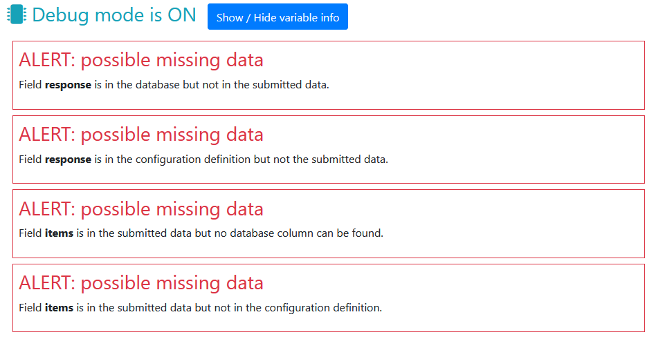

# Testing data on survey pages and the database

**NB tests will only run when a [debug mode](debug-mode.md) is set.**

## Describing the fields

NOTE can check that the fields *submitted by* the survey match the columns in the database (various INPUT, SELECT, TEXTAREA etc. elements). In order to test that the survey is correctly sending and receiving data, there needs to be a single 'source of truth' for the fields being used. As of NOTE 2.1 this can be managed within *config.php*.

The ```$_NOTE_MODULE['PAGES']``` array can contain arrays describing each page and providing some variables. The array can also contain field definitions describing what *should* appear on the page. By defining the data fields which should be sent by the page and present in the database table, NOTE can check that all are present and that 'page fields' match 'database fields.'

### NB

For testing to work, form fields must have the same names as database columns (maybe something  more flexible will appear in NOTE v3?). This is standard practice when using MVC frameworks such as [CakePHP](http://cakephp.org/) so is probably a good habit to aquire.

At present NOTE only tests for the *presence* of fields / columns, not that data complies with any restrictions (e.g. 'text only,' 'an integer between 20 and 60' etc.). This might be introduced in the future. In the meantime, it is suggested that HTML5 elements and attributes are used to enforce restrictions. Examples of INPUT types introduced with HTML5 can be found at [Mozilla HTML5 input types](https://developer.mozilla.org/en-US/docs/Learn_web_development/Extensions/Forms/HTML5_input_types) and [Client side form validation](https://developer.mozilla.org/en-US/docs/Learn_web_development/Extensions/Forms/Form_validation).

### Example

For example:

```php
$_NOTE_MODULE['PAGES'][] = [
    'PAGE' => 'sortable',
    'TABLE' => 'sortables', 
    'FIELDS' => [
        'response' => 'TEXT'
    ]
];
```

This array entry shows that the page *page_sortable.php* will contain the data field *response* and will be saving data into the table called *sortables*. It is implied that the table should *also* contain a column called *response.*

```php
    'FIELDS' => [
        'field' => 'SQLite column type',
        'field' => 'SQLite column type',
        'field' => 'SQLite column type',
        ...
    ]
```

Fields are described as an associative array where the key is the name of the field and the value is an SQLite column definition (usually TEXT, INTEGER or DATETIME).

Before the data is handed to the user function *db_save_page_data()* NOTE checks for the presence of a field in the ```$_POST``` data and the database. If either are missing, an error is displayed. NOTE also checks the reverse, looking for ```$_POST``` data and database columns that aren't present in the FIELDS definition.

A series of example warning messages are shown below. The field *items* is present on the page but not in the *config.php* definition or the database, and the field *response* **isn't** on the page but **is** in the definition and the database. This implies that the field on the page has been mis-named, but of course in all instances of alerts **the messages should be checked.**



Yes, the messages are intrusive and annoying. That's the point! Don't forget that they won't be displayed when you switch off debug mode.

## Special fields

There is an additional configuration option covering fields that appear on *every* page: ```$_NOTE_MODULE['SPECIAL_FIELDS']```. **Be aware that this key should only be defined once for the survey and should not appear in the ```$_NOTE_MODULE['PAGES']``` array.**

## Fields common to all pages

If all pages contain a particular field, it could be tiresome to add the information to every page definition in *config.php*. Instead these common fields can be defined within 'SPECIAL_FIELDS'. The 'COMMON' subkey lists fields that will be present on every page.

```php
$_NOTE_MODULE['SPECIAL_FIELDS'] = [
    'COMMON' => [
        'participant_id' => 'TEXT'
    ]
];
```

Fields are described as an associative array where the key is the name of the field and the value is an SQLite column definition (usually TEXT, INTEGER or DATETIME).

## Fields that should be ignored

A survey may also contain fields that should be ignored because they don't contain experiment data or will never be present in the $_POST data. These can be described in SPECIAL_FIELDS using the ['IGNORE'] key:

```php
$_NOTE_MODULE['SPECIAL_FIELDS'] = [
    'IGNORE' => [
        'id' => 'INTEGER',
        'uid' => 'TEXT', 
        'timestamp' => 'DATETIME',
        'page' => 'TEXT',
        'nextpage' => 'TEXT'
    ]
];
```

Fields are described as an associative array where the key is the name of the field and the value is an SQLite column definition (usually TEXT, INTEGER or DATETIME).
