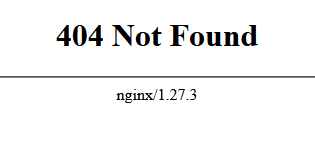

# Using native installs of nginx and php to set up a development environment

The Nginx and PHP services required for local development aren't applications that are installed but zip archives that are downloaded and decompressed. For this reason it is recommended that a folder structure is created independently of `C:\Program Files`. This example uses `C:\APPS\nginx` and `C:\APPS\nginx\php` although any folder(s) could be chosen.

Nginx can be downloaded from [http://nginx.org/en/download.html](http://nginx.org/en/download.html). The 'mainline' version with *Windows* in its name should be chosen. 

Unzip the Nginx archive to `C:\APPS\nginx`. Be careful not to create an unnecessary extra subfolder like `C:\APPS\nginx\nginx-1.25.6`.

## Nginx Configuration

The Nginx configuration is contained within *nginx.conf* and divided into blocks surrounded by {} brackets. There may be some initial configuration lines followed by an *events* block. The main block is the *http* block which can contain one or more *server* blocks.

The configuration example below could be used in a **local development environment**. Create a file in the `C:\APPS\nginx\conf` subdirectory called `nginx.conf` and copy and paste the configuration text into it. (If a file called `nginx.conf` already exists, rename the file to `nginx.conf.dist`.) Beware of Windows file extension conventions; Windows usually hides the file extension (*.conf*) and it's possible to create a file called *nginx.conf.txt* or even *nginx.conf.conf*. It may be necessary to use the Windows command line to check and rename your file.

**Do not use this configuration to set up a server in a live environment - a more secure setup will be needed. You proceed at your own risk.**

```conf
worker_processes  1;

events {
    worker_connections  1024;
}


http {
    include       mime.types;
    default_type  application/octet-stream;

    sendfile        on;
    keepalive_timeout  65;

    server {
        listen 9090;
        server_name localhost;
        index index.php;
        error_log c:/APPS/nginx/logs/localhost.error.log;
        access_log c:/APPS/nginx/logs/localhost.access.log;
        root c:/APPS/nginx/NOTE;

        location / {
            try_files $uri =404 /index.php?$query_string;
        }

        location /data/ {
            try_files $uri =404 /data.php?$query_string;
        }

        location ~ \.php {
            try_files $uri =404;
            fastcgi_split_path_info ^(.+\.php)(/.+)$;
            include fastcgi_params;
            fastcgi_param SCRIPT_FILENAME $document_root$fastcgi_script_name;
            fastcgi_param SCRIPT_NAME $fastcgi_script_name;
            fastcgi_index index.php;
            fastcgi_pass 127.0.0.1:9123;
        }
    }
}
```

This configuration will start a server at `http://localhost:9090` and enable PHP connections to a service running on port 9123. 9090 is an unusual port to use but will be useful if you choose to develop using other web-based languages that might require well-known ports.

To run nginx, open a command prompt (`cmd.exe`), `cd` to the folder c:\APPS\nginx and type `start nginx`. This runs the nginx program and returns a command prompt.

If you open a web browser and browse to `http://localhost:9090` you should see a 'file not found' page generated by nginx. This shows that the program is running (and working).



In the `location` section Nginx attempts to send PHP code to a PHP server running on port 9123. This will be set up in the next section.

## PHP-FPM

### Windows C++ redistributable

PHP requires the latest Microsoft Visual C++ Redistributable Version (including version 2019). The file can probably be obtained from this link: [https://aka.ms/vs/17/release/vc_redist.x64.exe](https://aka.ms/vs/17/release/vc_redist.x64.exe). Install the application; it may require administrative privileges to install.

Download the latest PHP package from [https://windows.php.net/download](https://windows.php.net/download). Choose the VS17 x64 Thread Safe Version and download the zip. Unzip this archive into `C:\APPS\nginx\php` (you might have to create the `php` folder first).

Open the `C:\APPS\nginx\php` folder and create a file called `php.ini`. If a `php.ini` is already present rename it to `php.ini.dist`. The text for an example *php.ini* can be found below. This can be copied and pasted into *c:\APPS\nginx\php\php.ini*  **at your own risk**.

```ini
; This is just an example file. Use this file, your own or modify settings *at your own risk*
;
[PHP]
engine = On
short_open_tag = Off
implicit_flush = Off
zend.enable_gc = On
expose_php = Off
max_execution_time = 30
max_input_time = 60
memory_limit = 512M
error_reporting = E_ALL & ~E_DEPRECATED & ~E_STRICT
display_errors = On
display_startup_errors = On
log_errors = On
variables_order = "GPCS"
request_order = "GP"
register_argc_argv = Off
auto_globals_jit = On
post_max_size = 8M
default_mimetype = "text/html"
default_charset = "UTF-8"
include_path = "."
extension_dir = "c:\APPS\nginx\php\ext"
enable_dl = Off
file_uploads = On
upload_max_filesize = 2M
max_file_uploads = 20
allow_url_fopen = On
allow_url_include = Off
default_socket_timeout = 60

extension=curl
extension=fileinfo
extension=gettext
extension=intl
extension=mbstring
extension=mysqli
extension=openssl
extension=pdo_mysql
extension=pdo_sqlite
extension=sqlite3

[Session]
session.save_handler = files
session.save_path = "c:\APPS\nginx\temp"
session.use_strict_mode = 0
session.use_cookies = 1
session.use_only_cookies = 1
session.name = PHPSESSID
session.auto_start = 0
session.cookie_lifetime = 0
session.cookie_path = /
session.cookie_domain =
session.cookie_httponly =
session.cookie_samesite =
session.serialize_handler = php
session.gc_probability = 1
session.gc_divisor = 1000
session.gc_maxlifetime = 1440
session.cache_limiter = nocache
session.cache_expire = 180
session.use_trans_sid = 0
session.sid_bits_per_character = 5
```

If a different PHP configuration is used, the following settings must be included and not commented out:

```ini
extension_dir = "c:\APPS\nginx\php\ext"

upload_max_filesize = 2M

extension=pdo_sqlite
extension=sqlite3
```

The extensions enable database access to SQLite files and the *extension_dir* paramter sets where these extensions can be found.

It may also be necessary to change the lines *memory_limit*, *post_max_size* and/or *upload_max_filesize* if particularly demanding code will be run.

## Starting and stopping the environment

### Starting Nginx and PHP

Nginx can be stopped with the command `nginx -s stop`. 

Nginx should be started before PHP. This is because PHP runs a debug server in the window and control of the command prompt won't be returned.

```cmd
start nginx
php\php-cgi.exe -b 127.0.0.1:9123 -c php\php.ini
```

- -b binds the server to the IP address 127.0.0.1 and port 9123. You can use other ports but be aware to change the port information in the Nginx configuration file *nginx.conf*. Look for the directive *fastcgi_pass*.
- -c configuration file to use. This is likely to be *php.ini* but if you have created a different configuration file it will need to be specified here. **If you do not specify a file, *php.ini* will be used.**

If the error `PHP Warning:  'C:\WINDOWS\SYSTEM32\VCRUNTIME140.dll' 14.38 is not compatible with this PHP build` is displayed then the installation of the C++ redistributable must be updated (see above).

### Stopping PHP and Nginx

If the PHP window is still open - it should be - then CTRL-C should be enough to stop the PHP server. Then stop Nginx using `nginx -s stop`.

## Add the NOTE files

The Nginx configuration file above uses `C:\APPS\nginx\NOTE` as the location for the NOTE files. The files can be placed somewhere else but the configuration file must be changed accordingly.

Extract the NOTE archive to `C:\APPS\nginx\NOTE`. You should see files and folders including:

- `C:\APPS\nginx\NOTE\index.php`
- `C:\APPS\nginx\NOTE\data.php`
- `C:\APPS\nginx\NOTE\modules\`
- `C:\APPS\nginx\NOTE\css\`

## Testing

To test the installation, visit the following URL:

`http://localhost:9090/`

You should see a title page containing several warnings about unidentified variables and arrays.


These messages have been generated by PHP running `index.php`. This demonstrates that (a) Nginx and PHP are running and (b) the `index.php` file has been read successfully.

Warning messages wouldn't be displayed on the live site but it is recommended to display them on the local development environment because they are usually an indicator of a problem (or something that *will* be a problem).

## Editing scripts

Any competent text editor can be used, but Visual Studio Code, VS Codium or Zed are recommended.

## DB Browser for SQLite

## Visual Studio Code or VS Codium

This can be downloaded and installed from here: [Get Visual Studio Code](https://code.visualstudio.com/)

VS Codium can be downloaded from here: [Get VS Codium](https://vscodium.com/). 

VS Code installs into a user profile so no admin privileges should be required. Once installed, it can be set up to work with PHP. 

- In Visual Studio Code, go to the plugins section and install *PHP Intelephense*
- You will need to provide the path to the PHP executable. Open the file:
  - `%APPDATA%\Code\User\settings.json`
- (Create the file if necessary)
- and add the following:
  - `"php.validate.executablePath": "C:\\APPS\\nginx\\php\\php.exe",`
- Include the double quotes and the comma. If you needed to create the `settings.json` file, enclose the line with {} braces. If you unzipped PHP into a different folder use that in the configuration above.

The whole *settings.json* file might look like this:

```json
{
    "php.validate.executablePath": "C:\\APPS\\nginx\\php\\php.exe",
}
```

That should be enough for Visual Studio Code to access PHP and for Intelephense to produce debugging information.
