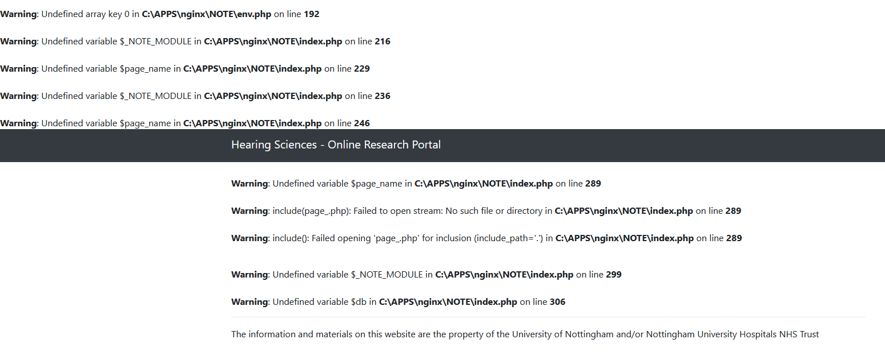

# Using native installs of nginx and php to set up a development environment

The Nginx and PHP services required for local development aren't applications that are installed but zip archives that are downloaded and decompressed. For this reason it's best to use a folder structure away from `C:\Program Files`. I have used `C:\APPS\nginx` and `C:\APPS\nginx\php` although you could use anything you like.

Nginx can be downloaded from [http://nginx.org/en/download.html](http://nginx.org/en/download.html). Get the mainline zip version with 'Windows' in its name. I would recommend unzipping the Nginx archive to `C:\APPS\nginx`. Be careful not to create a 'double path' like `C:\APPS\nginx\nginx-1.25.6`.

## Nginx Configuration

The Nginx configuration is contained within *nginx.conf* and divided into blocks surrounded by {} brackets. There may be some initial configuration lines followed by an *events* block. The main block is the *http* block and within can be found one or more *server* blocks.

Here’s the server configuration that I use in a **local dev environment**. Put this or something similar into the `conf` subdirectory and call it `nginx.conf`.

**Do not use this configuration to set up a server in a live environment - you will need a more secure setup. You proceed at your own risk.**

There is a section of the config file marked *Section for password protecting data pages* that can be excluded from test environments.

```conf
worker_processes  1;

events {
    worker_connections  1024;
}


http {
    include       mime.types;
    default_type  application/octet-stream;

    sendfile        on;
    keepalive_timeout  65;

    server {
        listen 9090;
        server_name localhost;
        index index.php;
        error_log c:/APPS/nginx/logs/localhost.error.log;
        access_log c:/APPS/nginx/logs/localhost.access.log;
        root c:/APPS/nginx/NOTE;

        location / {
            try_files $uri =404 /index.php?$query_string;
        }

        location /data/ {
            try_files $uri =404 /data.php?$query_string;
        }

        # Section for password protecting data pages
        location ~ /data/([0-9a-z\-_]+)/ {
            try_files $uri $uri/ =404 /data.php?$query_string;
            auth_basic      "Please enter your password to continue";
            auth_basic_user_file    c:/APPS/nginx/htpasswd/htpasswd_$1;
        }

        location /dev/ {
            try_files $uri =404 /dev/index.php?$query_string;
        }

        location /dev/data/ {
            try_files $uri =404 /dev/data.php?$query_string;
        }

        location ~ \.php {
            try_files $uri =404;
            fastcgi_split_path_info ^(.+\.php)(/.+)$;
            include fastcgi_params;
            fastcgi_param SCRIPT_FILENAME $document_root$fastcgi_script_name;
            fastcgi_param SCRIPT_NAME $fastcgi_script_name;
            fastcgi_index index.php;
            fastcgi_pass 127.0.0.1:9123;
        }
    }
}
```

This will start a server at `http://localhost:9090` and enable PHP connections to a service running on port 9123. 9090 is an unusual port to use but will be useful if you choose to develop using something like React later.

In the `location` section Nginx attempts to send PHP code to a PHP server running on port 9123. This will be set up in the next section.

## PHP-FPM

Download the latest PHP package from [https://windows.php.net/download](https://windows.php.net/download). Choose the VS16 x64 Thread Safe Version unless you have a good reason to do otherwise and get the zip. Unzip this archive into `C:\APPS\nginx\php` (you might have to create the `php` folder first).

PHP might require a configuration change to work with SQLite. Open the PHP folder and look for a file called *php.ini*. Make sure the following settings are included and not commented out:

```ini
extension_dir = "c:\APPS\nginx\php\ext"

upload_max_filesize = 2M

extension=pdo_sqlite
extension=sqlite3
```

Don't expect to find these lines grouped together; they might be anywhere in the file. The extensions enable database access to SQLite files and the *extension_dir* paramter sets where these extensions can be found.

You might also want to consider changing the lines *memory_limit*, *post_max_size* and/or *upload_max_filesize* if you are running particularly demanding code.

### Sample PHP configuration file

An example *php.ini* can be found in the *server-config/php* folder. You can use this if you like but it's at your own risk.

## Files

Download a release of NOTE and uncompress the zip archive to ```C:\APPS\nginx\NOTE```. There should be files such as:

- ```C:\APPS\nginx\NOTE\index.php```
- ```C:\APPS\nginx\NOTE\data.php```
- ```C:\APPS\nginx\NOTE\components\header.php```

... and so on.

## Starting and stopping

### Start

Start Nginx before PHP. This is because PHP runs a debug server in the window and the command prompt won't be returned.

```cmd
start nginx
php-cgi.exe -b 127.0.0.1:9123 -c php.ini
```

- -b binds the server to the IP address 127.0.0.1 and port 9123. You can use other ports but be aware to change the port information in the Nginx configuration file *nginx.conf*. Look for the directive *fastcgi_pass*.
- -c configuration file to use. This is likely to be *php.ini* but if you have created a different configuration file it will need to be specified here. **If you do not specify a file, *php.ini* will be used.**

### Stop

If the PHP window is still open - it should be - then CTRL-C should be enough to stop the PHP server. Then stop Nginx using `nginx -s stop`.

## Add the NOTE files

The Nginx configuration file above uses `C:\APPS\nginx\NOTE` as the location for the NOTE files. Again, you can put the files somewhere else and change the folder in the configuration file.

Download the NOTE archive from GitHub ([https://github.com/Hearing-Sciences/note](https://github.com/Hearing-Sciences/note)) and unzip it to `C:\APPS\nginx\NOTE`. You should see files and folders like:

- `C:\APPS\nginx\NOTE\index.php`
- `C:\APPS\nginx\NOTE\data.php`
- `C:\APPS\nginx\NOTE\modules\`
- `C:\APPS\nginx\NOTE\css\`

(There will be many more.)

## Testing

Everything is in place so try visiting:

`http://localhost:9090/`

This will work but display a lot of warning messages.



These messages have been generated by PHP running `index.php`. So you know that (a) Nginx and PHP are running and (b) you have successfully opened the `index.php` file.

Warning messages wouldn't be displayed on the live site but it's a good idea to see them here as they are usually an indicator of a problem (or something that *will* be a problem).

Once you have NOTE installed locally, you're going to want to write some surveys! Any competent text editor can be used, but Visual Studio Code is recommended.

## DB Browser for SQLite

## Visual Studio Code

This can be downloaded and installed from here: [Get Visual Studio Code](https://code.visualstudio.com/)

If you are concerned about Microsoft rummaging through your stuff you could install VS Codium instead from here: [Get VS Codium](https://vscodium.com/). Or you could use one of a variety of other text editors such as Notepad++.

VS Code installs into your user profile so no admin privileges should be required. Once installed, it's a good idea to set it up to work with PHP. I recommend the following steps:

- In Visual Studio Code, go to the plugins section and install *PHP Intelephense* (Yes, it really is called that; PHP's symbol/mascot is an elephant)
- You will need to provide the path to the PHP executable. Open the file:
  - %APPDATA%\Code\User\settings.json
- (Create the file if necessary)
- and add the following:
  - `"php.validate.executablePath": "C:\\APPS\\nginx\\php\\php.exe",`
- Include the double quotes and the comma. If you needed to create the file, enclose the line with {} braces. If you unzipped PHP into a different folder use that in the configuration above.

The whole *settings.json* file might look like this:

```json
{
    "php.validate.executablePath": "C:\\APPS\\nginx\\php\\php.exe",
}
```

That should be enough for Visual Studio Code to access PHP and for Intelephense to produce debugging information.
